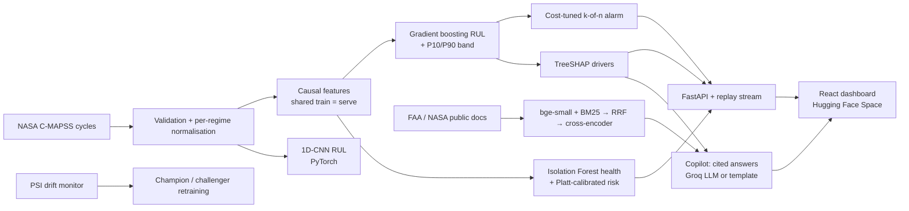

# TurboWatch — Fleet Health & Predictive Maintenance Copilot

**Predicts how many flight cycles each turbofan engine has left, raises cost-tuned maintenance alarms ~36 cycles before failure, and explains every prediction — built and evaluated honestly on NASA C-MAPSS.**

[](https://github.com/Dyaus2/turbowatch/actions/workflows/ci.yml)
[](LICENSE)

[](https://colab.research.google.com/github/Dyaus2/turbowatch/blob/main/notebooks/turbowatch_colab.ipynb)

> Live demo: *in progress (milestone 2 — dashboard + Hugging Face Space).*

## Why it matters
Unplanned engine removals are among the most expensive events in airline and defence operations. Fixed-interval maintenance replaces parts too early or too late. TurboWatch shows the core of a condition-based maintenance system:
1. **Remaining useful life (RUL)** per engine with an uncertainty band,
2. a **calibrated health risk** (probability of failure within 30 cycles),
3. an **alarm policy tuned on a cost matrix** (missed failure = 100, needless inspection = 10),
4. **SHAP explanations** naming the sensors behind each prediction.

## Results (held-out only, reproducible)
FD001, mean ± std over 5 seeds. Full table: [`results/RESULTS.md`](results/RESULTS.md) (generated by `scripts/make_results.py` from `results/runs/*.json`).

| | Official test set (100 engines) | Held-out run-to-failure engines (15 per seed) |
|---|---|---|
| RUL RMSE — gradient boosting | **16.26 ± 0.66** cycles | 15.94 ± 1.50 (all cycles) |
| RUL RMSE — 1D-CNN (CPU, 20 epochs) | **15.46 ± 0.61** cycles | 16.62 ± 0.79 (all cycles) |
| PHM08 score — gradient boosting / CNN | 455 ± 70 / 465 ± 61 | – |
| Alarm detection rate (predicted-RUL policy) | **97 ± 5%** of the 25 engines that reach the 30-cycle danger zone | 100 ± 0% |
| False-alarm rate (alarm while true RUL > 60) | **2 ± 2%** of engines | 8 ± 5% |
| Median warning before failure | **36 ± 5 cycles** | 37 ± 5 cycles |

Other C-MAPSS subsets (single seed, same code; FD002/FD004 use 6-regime normalisation) — test RMSE gradient boosting / 1D-CNN: **FD002 14.94 / 16.12 · FD003 15.16 / 16.32 · FD004 16.50 / 17.16** (details in `results/RESULTS.md`).

Evaluation protocol: training engines are split **by engine** into fit (70%) / calibration (15%) / holdout (15%). Models are fitted on *fit*; the risk calibrator, the alarm policy and the model selection use *calibration* only; *holdout* and the official *test* set are touched only for reporting. Features are causal (row *t* uses cycles ≤ *t*) and produced by one `FeaturePipeline` object shared by training and serving — enforced by tests.

What did **not** work (kept in the table on purpose): the autoencoder health score separates degraded from healthy cycles poorly, and its cost-optimal policy alarms on every engine; the Isolation Forest risk is better calibrated (Brier 0.059) but detects only 62% of test failures, because test engines are cut before failure and the smoothed risk reacts late. The P10–P90 RUL band covers the truth in 66% of test engines (nominal 80%) — the quantile models are over-confident.

## Maintenance copilot (GenAI, grounded)
The engine page has an **"Explain this engine"** button and an **"Ask the manuals"** chat. Both retrieve passages from public FAA/NASA documents (FAA powerplant handbook turbine chapters, AC 120-17B, AC 120-16G, the NASA C-MAPSS paper; see [`docs/SOURCES.md`](docs/SOURCES.md)) and answer **with citations to the exact page**. Retrieval = bge-small dense + BM25 fused by reciprocal rank fusion, then a MiniLM cross-encoder rerank. The copilot **refuses** when the reranker finds nothing relevant. An LLM (Groq, `GROQ_API_KEY`) writes the answer when a key is configured; otherwise a template answer quotes the retrieved sentences. Decision support only.

Evaluation on 26 questions written from the documents + 4 out-of-scope questions ([`results/COPILOT.md`](results/COPILOT.md), `scripts/eval_copilot.py`):

| Retriever | hit@1 | hit@3 | MRR@10 |
|---|---|---|---|
| dense (bge-small) | 77% | 85% | 0.828 |
| BM25 | 85% | 96% | 0.913 |
| hybrid (RRF) | 77% | 92% | 0.854 |
| **hybrid + cross-encoder rerank (production)** | **100%** | **100%** | **1.000** |

Out-of-scope questions refused: 4/4 · gold fact present in the cited passages: 100% · in the template answer text: 69% (the template is extractive; the LLM path is evaluated when a key is available). Small, self-written set — indicative, not a benchmark.

## Architecture


## MLOps: drift & champion/challenger
`scripts/drift_scenario.py` streams a new fleet (FD003, which adds a fan-degradation mode) past the FD001 model. PSI against the healthy FD001 baseline: **0/15 sensors drift on the FD001 test stream vs 9/15 on the FD003 stream** already in its healthy phase. A challenger retrained on FD001+FD003 is promoted by a rule evaluated on calibration engines only; after the decision, FD003 test RMSE drops **20.73 → 14.96** with no regression on FD001 (16.64 → 14.60). Details: [`results/DRIFT.md`](results/DRIFT.md). Model & data cards: [`docs/MODEL_CARD.md`](docs/MODEL_CARD.md), [`docs/DATA_CARD.md`](docs/DATA_CARD.md).

## How it works
```
C-MAPSS cycles ─► validation ─► per-regime normalisation (KMeans on operating settings; 1 regime FD001/3, 6 regimes FD002/4)
               ─► causal features (rolling mean/std 5 & 15, 15-cycle slope, EWM)  ← same object at train & serve time
               ├─► Gradient boosting RUL + P10/P90 quantile models ─► SHAP TreeExplainer (exact, additive)
               ├─► 1D-CNN on 30-cycle windows (PyTorch)
               └─► Isolation Forest / autoencoder on healthy cycles ─► causal EWM ─► Platt calibration ─► risk
                                                       ▼
                         k-of-n alarm policy tuned on calibration engines (cost: miss 100, false alarm 10)
```
Every run is logged to MLflow (`mlruns/`, SQLite store).

## Run it
```bash
pip install torch==2.15.0 --index-url https://download.pytorch.org/whl/cpu
pip install -r requirements.txt -r requirements-dev.txt && pip install -e . --no-deps
python scripts/train.py --subsets FD001 --seeds 0 1 2 3 4   # downloads NASA data, ~50 s per seed on 4 CPU cores
python scripts/make_results.py                             # regenerates results/RESULTS.md
pytest -q && ruff check .
cd frontend && npm ci && npm run build && cd ..              # dashboard (served by the API at /)
uvicorn turbowatch.api:app --port 7860                      # API + dashboard on http://localhost:7860
python scripts/build_corpus.py && python scripts/eval_copilot.py   # rebuild copilot corpus + evaluation
mlflow ui --backend-store-uri sqlite:///mlruns/mlflow.db    # experiment tracking
```
**Colab (T4 GPU):** [`notebooks/turbowatch_colab.ipynb`](notebooks/turbowatch_colab.ipynb) clones the repo, trains everything (CNN on GPU, 60 epochs, 3 seeds) and plots a test engine with SHAP drivers.

## Project structure
```
src/turbowatch/
  data.py        download, load, schema validation, true-RUL, synthetic data for tests
  features.py    FeaturePipeline: per-regime normalisation + causal features (train = serve)
  split.py       engine-grouped fit / calibration / holdout split
  models/gbm.py  gradient boosting RUL + quantile band       models/cnn.py  1D-CNN (PyTorch)
  health.py      Isolation Forest, autoencoder, causal smoothing, Platt risk calibration, Brier/ECE
  alarm.py       k-of-n policy, engine-level outcomes, cost-matrix tuning
  explain.py     SHAP + sensor dictionary          metrics.py  RMSE, PHM08, coverage
  pipeline.py    end-to-end training/evaluation + MLflow     predictor.py  serving inference
  rag.py         copilot: hybrid retrieval + rerank, grounded answers with citations, LLM / template fallback
  api.py         FastAPI backend (fleet, engines, alarms, replay SSE, copilot) + serves the built dashboard
frontend/        React + TypeScript dashboard (fleet grid/table, engine detail, replay, copilot, how-it-works)
data/corpus/     cleaned document chunks + embeddings (public FAA/NASA texts)     data/eval/  copilot Q/A set
scripts/ train.py, make_results.py, build_corpus.py, eval_copilot.py, drift_scenario.py     tests/ unit, leakage, pipeline, API, copilot
results/ RESULTS.md, summary.json, runs/*.json     artifacts/FD001/ serving bundle (3 MB)
```

## Tech stack
Python 3.13 · pandas · scikit-learn · PyTorch · SHAP · MLflow · FastAPI · sentence-transformers (bge-small, MiniLM cross-encoder) · BM25 · Groq LLM API · React 19 + TypeScript + Tailwind 4 + Recharts · Docker · Hugging Face Spaces · pytest · ruff · GitHub Actions.

## Limitations
- C-MAPSS is **simulated** data with a single, fixed failure definition; real fleets have maintenance actions, sensor faults and censoring.
- Holdout sets are small (15 engines per seed), hence the seed-to-seed spread reported above.
- RUL is capped at 125 cycles (standard practice), so early-life predictions are deliberately flat.
- Decision support only — not a certified airworthiness or maintenance tool.

## Data & licenses
NASA C-MAPSS (public, NASA PCoE) — see [`docs/SOURCES.md`](docs/SOURCES.md). Code: MIT.

## Author
**Hazem Ilahi** — Data Science & AI engineering student (ESPRIT), seeking a 6-month end-of-studies internship from Jan/Feb 2027.
[Portfolio](https://dyaus2.github.io) · [LinkedIn](https://www.linkedin.com/in/hazem-ilahi-016a7a315) · [GitHub](https://github.com/Dyaus2)
